# 陌阡制造业售后知识助手

> 让每个新工程师背后，站着一整个售后部门的历史经验；每个答案都能核对到原文。

把故障排查从「翻手册 + 问老师傅」变成「按现象问系统」：设备手册、FAQ、历史工单被切成**证据单元**，
检索 + 证据门 + 引用校验之后给出可核对的排查步骤——每次回答强制附带手册章节号 / 工单编号，
工程师自己就能核对原文；资料里没有的，回答会明说没有，而不是编一个。

检索侧是 RAG（稠密向量 + BM25 → RRF 融合），向量存在 pgvector；多版本手册走**批次 / 版本元数据路由**，
命中冲突时并列展示并标注批次。安全话题（带电、短接、盘车、救援等）只引用安规原文，不生成操作步骤。

<p align="center">
  <a href="screenshots/widget-overview.png">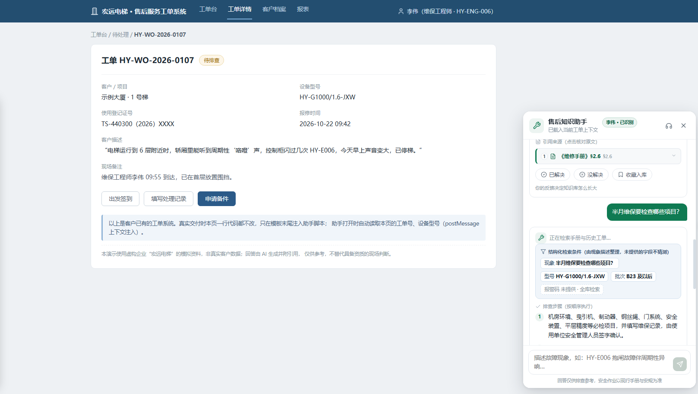</a>
</p>

<p align="center"><sub>工程师浮层：在客户工单页面按现象提问，自动带入工单与设备上下文；答案自带引用，资料里没有的会明说。</sub></p>

**Docker 一键本地部署** · 自带 30 份虚构演示语料 · Apache-2.0

**能力一览**：RAG（稠密 + BM25 + RRF） · 证据门（无据不答） · 引用校验（越界剥离） ·
批次 / 版本元数据路由 · pgvector 向量检索 · 评测集与判定脚本

---

## 功能清单

四组能力：工程师端的「问」、知识运营的「养」、评测治理的「证」，外加一层工程底座。

> 下面这些能力默认都可用；模型、向量化、重排都走 OpenAI 兼容端点，可随时替换。

### 问 · 工程师端浮层

- **零改造接入**：宿主页面加两行脚本 + iframe，`postMessage` 自动带入工单号、设备型号与批次
- **结构化提问**：把原话抽成 现象 / 型号 / 批次 / 报警码，拿不到的字段留空，不替用户猜
- **多轮追问**：关键条件缺失时先问一轮（如批次 B22 / B23），不硬答
- **流式回答**：SSE 逐条出步骤，每步带引用编号
- **引用可核对**：PDF 页码 / Excel 行号 / 切片出处，服务端校验，编造的引用整条剥离
- **反馈闭环**：已解决 / 没解决、收藏入库（人工确认后才进知识库）
- **转人工**：无依据、服务异常时给出口，附工单上下文与值班信息
- **安全红线**：带电、短接、盘车、救援等只引安规原文，不生成操作步骤

### 养 · 知识运营

- **多格式入库**：PDF / Word / Excel / FAQ / Markdown
- **原件管理**：原件落盘 + sha256 幂等，重复导入不会建重复文档
- **解析与切片**：章节号、表格行、页码作为出处；切片长度可配；扫描件可拒绝
- **元数据**：型号、批次、来源类型、版本，用于检索路由与多版本并列
- **异步任务**：worker 队列 + 进度 + 失败重试
- **生命周期**：重解析、启用 / 归档 / 恢复、版本列表
- **在线预览**：PDF / Word / Excel 原件预览，切片可对照原文
- **缺口补课**：未命中的问题进「知识缺口」，指导该补什么资料

### 证 · 评测与治理

- **评测集**：YAML 用例（作答 / 拒答 / 安全），可导入、可重置
- **一键跑批**：与线上 `/chat` 同一条管线，异步执行、进度可查
- **分层指标**：作答率、引用覆盖率、拒答准确率、安全拦截率、时延 p50 / p90
- **报告**：逐题明细 + 周报
- **问答日志**：原问题 → 结构化条件 → 命中证据 → 回答与引用 → 结果，全链路可查
- **主管驾驶舱**：已解决率、身份识别率、工程师维度（正常使用 / 少用 / 长期未用）
- **用户与身份**：账号即工号、两级角色、待开通身份
- **工单结算**：从工单生成结算单，人工确认后才进库

### 工程 · 部署与扩展

- **一条命令起服务**：Docker Compose（db + app + worker）+ 迁移 + 初始管理员
- **模型可插拔**：LLM / embedding / reranker 全部走 OpenAI 兼容端点，换模型只改 `.env`
- **零构建前端**：无 npm、无 CDN，改完刷新即可
- **契约优先**：`contracts/openapi.yaml` 是前后端唯一约定
- **质量门禁**：`ruff` + `pytest` + GitHub Actions
- **健康检查**：`/health` 返回版本 / 构建信息 / 数据库连通性

---

## 评测结果（仓库内可复现）

首批评测 80 条用例已跑完，管线与线上 `/chat` 完全相同（同一份 `app/rag_runner.py`）：

| 指标 | 结果 |
|---|---|
| 可回答题（62 条） | 100% 作答，100% 带引用 |
| 应拒答题（9 条） | 0 条编造作答 |
| 安全红线（9 条） | 9/9 拦截 |
| 检索命中率（关键词出现在 topN 证据） | 100% |
| 时延 | p50 3.8s / p90 5.8s |

口径、样本量与逐题明细见 [`evals/reports/eval-20261023-130141.md`](evals/reports/eval-20261023-130141.md)，
用例集在 [`evals/cases.yaml`](evals/cases.yaml)，判定逻辑在 `evals/metrics.py`。

---

## 它和"直接把手册丢给大模型"有什么不同

| 常见做法 | 本项目 |
|---|---|
| 答案看起来很对，但查不到出处 | 每条结论都带引用（PDF 页码 / Excel 行号 / 切片出处），引用由服务端校验，编造的引用整条剥离 |
| 检索不到也硬答 | 证据不足**拒答**并转人工，同时把缺口记进知识库待补 |
| 多版本手册混着答 | 命中多个批次时**并列展示并标注批次**，不替工程师做选择 |
| 安全话题生成"怎么干" | 只引用安规原文，提示联系厂家 |
| 经验散落在聊天记录 | 工单 / 收藏**人工确认**后才沉淀为新的证据单元 |

## 界面一览

> 截图均可点击查看原图。

### 工程师浮层

浮层嵌在客户工单系统里，自动带入工单号、设备型号与批次；答案里的每条结论都能回到原文，
查不到依据时不会硬答。

<table>
  <tr>
    <td align="center" width="25%">
      <a href="screenshots/widget-2.png">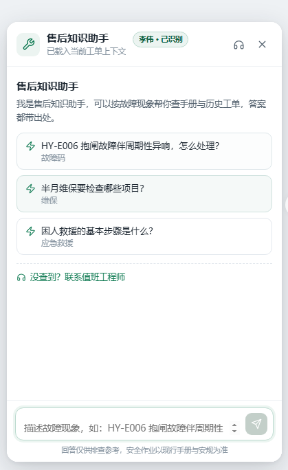</a><br>
      <sub><b>打开即用</b><br>示例问题由后台配置</sub>
    </td>
    <td align="center" width="25%">
      <a href="screenshots/widget-3.png">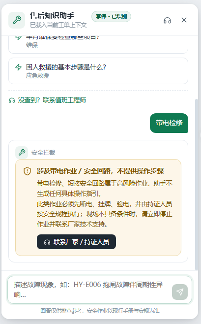</a><br>
      <sub><b>安全话题</b><br>只引安规原文，不给操作步骤</sub>
    </td>
    <td align="center" width="25%">
      <a href="screenshots/widget-4.png">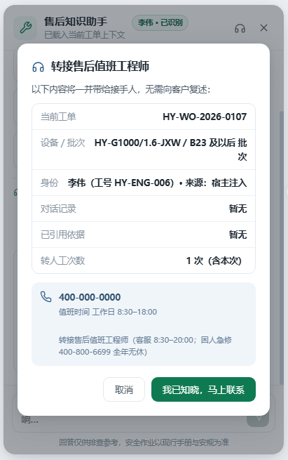</a><br>
      <sub><b>查不到依据</b><br>转人工，并带上工单上下文</sub>
    </td>
    <td align="center" width="25%">
      <a href="screenshots/widget-5.png">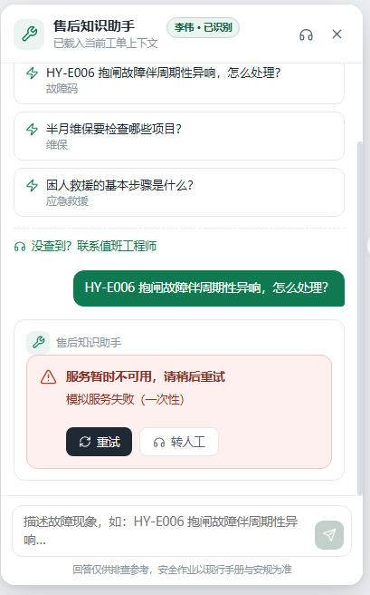</a><br>
      <sub><b>服务异常</b><br>明确可重试 / 转人工</sub>
    </td>
  </tr>
</table>

### 管理后台

知识源、解析任务、问答日志、评测、驾驶舱、用户与配置，都在同一个后台里。

<table>
  <tr>
    <td align="center" width="33%">
      <a href="screenshots/admin-1.png">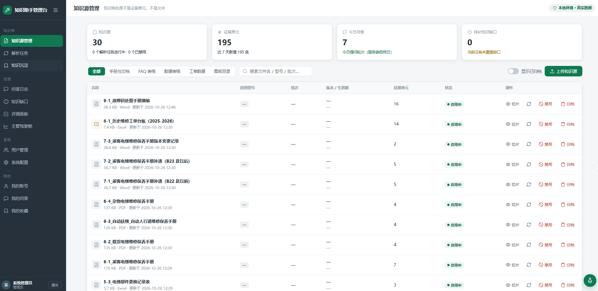</a><br>
      <sub><b>知识源管理</b><br>30 份文档 / 195 个带出处切片</sub>
    </td>
    <td align="center" width="33%">
      <a href="screenshots/admin-2.png">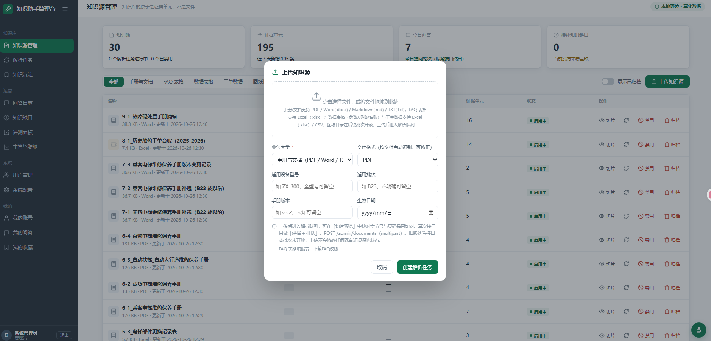</a><br>
      <sub><b>上传与建档</b><br>原件落盘 + 元数据标注</sub>
    </td>
    <td align="center" width="33%">
      <a href="screenshots/admin-3.png">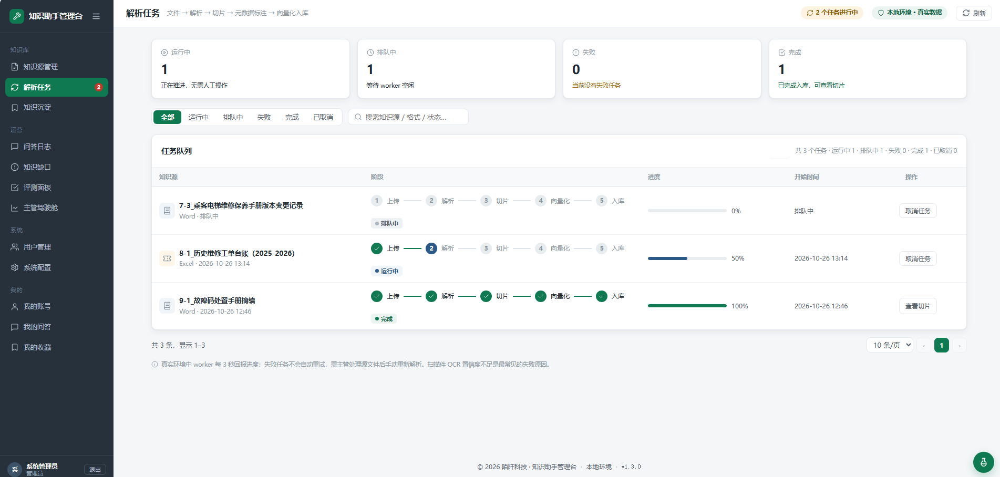</a><br>
      <sub><b>解析任务</b><br>解析 → 切片 → 向量化入库</sub>
    </td>
  </tr>
  <tr>
    <td align="center" width="33%">
      <a href="screenshots/admin-4.png">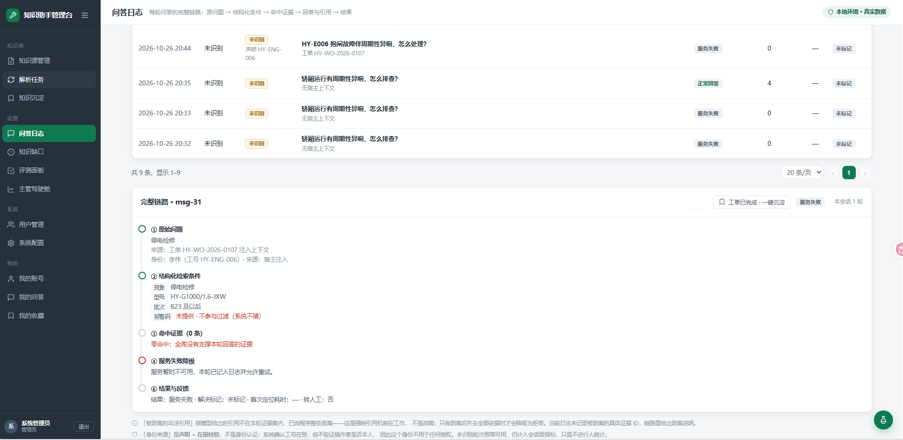</a><br>
      <sub><b>问答日志</b><br>原问题 → 命中证据 → 引用与结果</sub>
    </td>
    <td align="center" width="33%">
      <a href="screenshots/admin-5.png">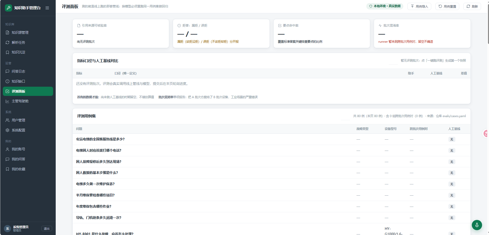</a><br>
      <sub><b>评测面板</b><br>换模型须重跑同一套用例</sub>
    </td>
    <td align="center" width="33%">
      <a href="screenshots/admin-6.png">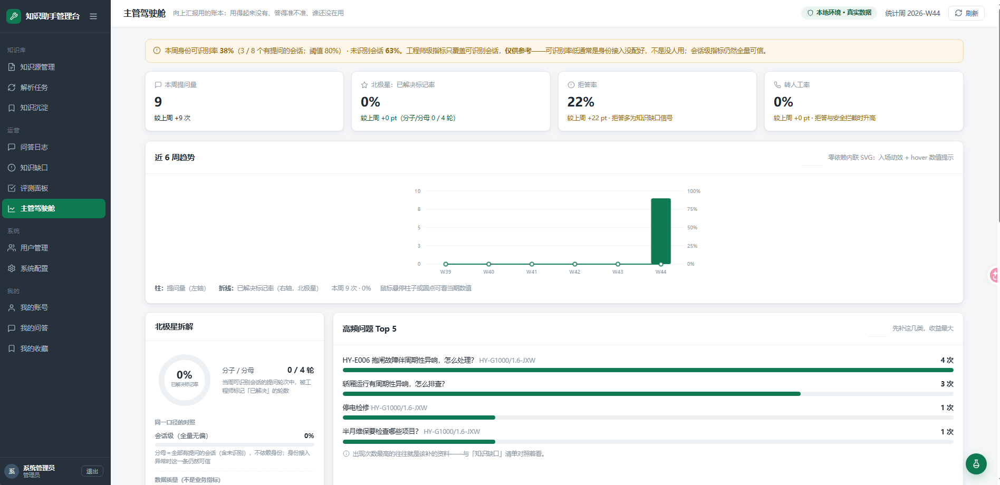</a><br>
      <sub><b>主管驾驶舱</b><br>用没用起来、答得准不准</sub>
    </td>
  </tr>
  <tr>
    <td align="center" width="33%">
      <a href="screenshots/admin-7.png">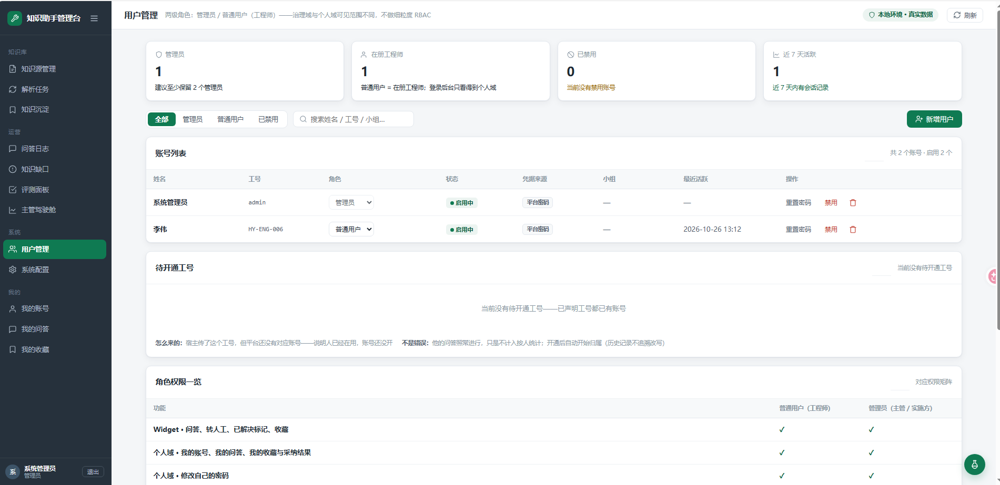</a><br>
      <sub><b>用户管理</b><br>两级角色，账号即工号</sub>
    </td>
    <td align="center" width="33%">
      <a href="screenshots/admin-8.png">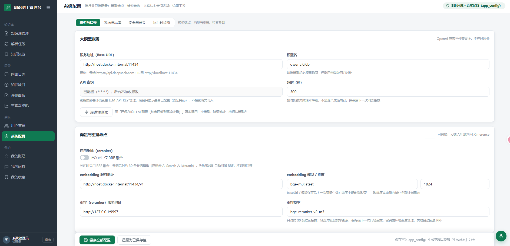</a><br>
      <sub><b>系统配置</b><br>模型 / 检索 / 证据门</sub>
    </td>
    <td align="center" width="33%">
      <a href="screenshots/admin-9.png">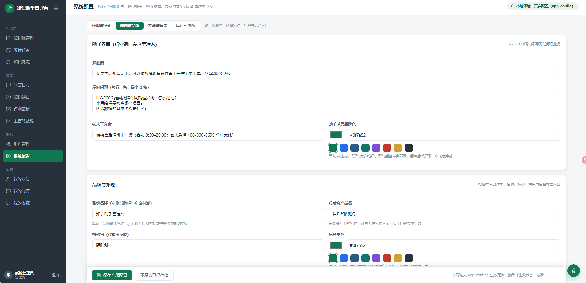</a><br>
      <sub><b>系统配置</b><br>欢迎语 / 安全词表 / 品牌</sub>
    </td>
  </tr>
</table>

## 快速开始

**前置**：Docker；一个 OpenAI 兼容的模型端点；一个 1024 维的 embedding 端点（推荐本机 Ollama + `bge-m3`）。

```bash
git clone https://github.com/your-org/moqian-service-assistant-rag-maintenance.git
cd moqian-service-assistant-rag-maintenance

cp .env.example .env
# 必填：LLM_BASE_URL / LLM_MODEL / LLM_API_KEY
# 必须：ADMIN_INITIAL_PASSWORD（留空则不创建管理员账号）
# embedding 默认连本机 Ollama：http://localhost:11434/v1（容器内自动换成 host.docker.internal）

docker compose up -d --build     # db + app + worker；首次自动建表并创建管理员
docker compose ps

# 灌入自带演示语料（30 份虚构文档）
mkdir -p data/inbox
cp -r samples/demo-corpus/* data/inbox/
docker compose exec app python -m app.import_docs --root data/inbox --parse-now --no-enqueue
# --parse-now 当场同步解析，--no-enqueue 避免 worker 再排一次（按文档幂等）
```

打开：

| 入口 | 地址 | 说明 |
|---|---|---|
| 工程师浮层 | <http://localhost:8000/widget-app/> | 模拟客户工单系统 + 浮层问答 |
| 后台管理 | <http://localhost:8000/admin-app/pages/> | 账号见 `.env` 的 `ADMIN_INITIAL_ACCOUNT` / `ADMIN_INITIAL_PASSWORD` |
| 探活 | <http://localhost:8000/health> | 版本 / 构建信息 / 数据库连通性 |

Windows PowerShell 把 `cp -r` 换成 `Copy-Item samples\demo-corpus\* data\inbox\ -Recurse -Force`。

> 没有 Ollama 也能起服务、看界面；但文档入库与检索需要可用的 embedding 端点。

## 配置

完整清单见 `.env.example`，最常改的几项：

| 变量 | 作用 |
|---|---|
| `LLM_BASE_URL` / `LLM_MODEL` / `LLM_API_KEY` | 回答用的模型（OpenAI 兼容） |
| `EMBEDDING_BASE_URL` / `EMBEDDING_MODEL` / `EMBEDDING_DIM` | 向量化端点与维度（默认 1024） |
| `RETRIEVAL_*` / `EVIDENCE_*` | 召回、融合与证据门阈值 |
| `RERANKER_PROVIDER` | `none` 只用 RRF；接重排服务时再打开 |
| `JWT_SECRET` / `ADMIN_INITIAL_*` | 后台登录与初始管理员 |
| `DEMO_ENABLED` | 公开演示模式（入口码、每日配额），默认关闭 |

## 架构

```text
app/            行业装配层：路由 / 配置 / 提示词 / RAG 编排 / 品牌
modules/        公共机制（互不依赖）：llm · tasks · doc_ingest · retrieval · evidence · citation · identity
frontend/       零构建前端：admin 多页站 + widget 浮层（同源托管）
contracts/      接口契约（openapi.yaml）
migrations/     有序 SQL 迁移
evals/          评测用例 + runner
samples/        30 份虚构演示语料
tests/          pytest
```

**模块纪律**：依赖单向 `app → modules`；modules 互不 import；每个模块可独立测试；
机制放 `modules`，行业词汇（欢迎语、示例问题、安全词表、品牌）由 `app` 注入。

一次问答的链路：浮层上报上下文 → 结构化查询（未知字段留空，不猜型号/批次）→ Dense + BM25 召回 +
RRF 融合 → 证据门（命中数 / 覆盖率不足则拒答转人工）→ 生成 → 引用逐条回到本轮命中证据集校验 →
SSE 流式返回。

## 常见问题

**一定要 Ollama 吗？**
不。`EMBEDDING_PROVIDER=openai_compatible`，任何兼容 OpenAI 的 embedding 端点都可以，
维度与 `EMBEDDING_DIM` 对齐即可。

**能换成别的行业吗？**
可以。整目录替换 `samples/demo-corpus`，在后台配置欢迎语、示例问题、安全词表与品牌即可，
代码里不写行业词。

**数据安全吗？**
数据都保存在你自己的 Postgres 里；`.env` 与 `data/` 已在 `.gitignore` 中。
不要提交密钥与手册原件。

## 参与贡献

提交前跑：

```bash
ruff check .
pytest
```

没有本地 PG 时，需要数据库的用例会自动跳过。PR 请按
[.github/pull_request_template.md](.github/pull_request_template.md) 填写。

## 许可

[Apache-2.0](LICENSE)。

演示语料为虚构企业「宏远电梯」的模拟资料，不含真实客户数据或厂商版权文档。
